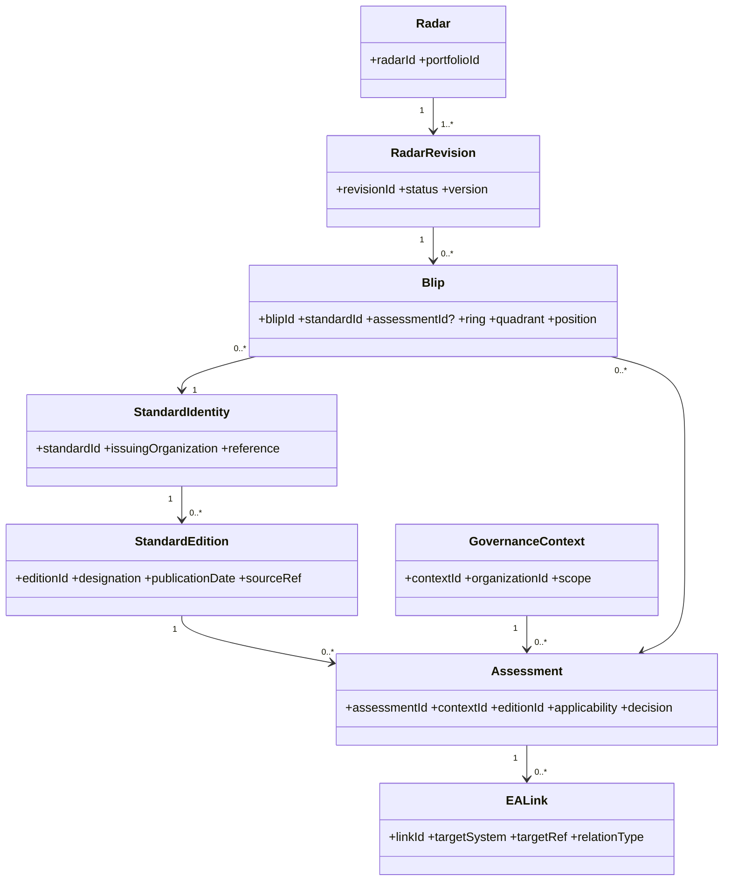
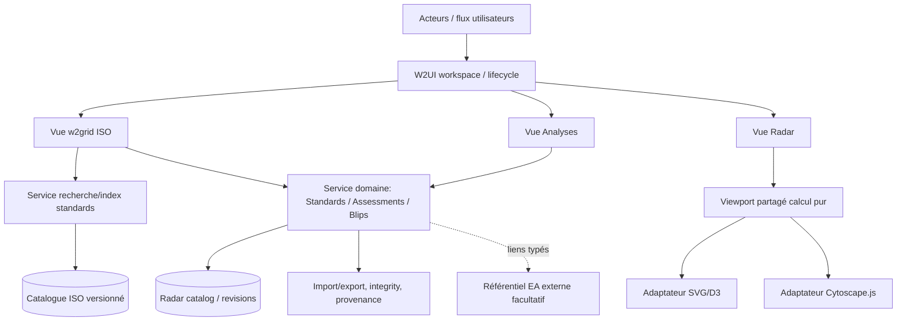

# S — Dossier de spécification consolidée : produit et solution cible

**Référence:** SRC-SPEC-0.1 · **Nature:** normative/TO-BE · **Status:** candidate, not approved · **Date:** 2026-11-06.

## S0. Règles de rédaction et statut

Chaque règle porte un identifiant `REQ-*`, repris dans `docs/requirements/requirements.csv`. `MUST` = exigence proposée pour la cible, **ne constitue pas une assertion sur l'application actuelle**. Les choix discutables sont `DEC-PROPOSED` ou `DEC-OPEN` dans le registre. Les interfaces, noms de modules et seuils de performance sont des propositions qui demandent une revue.

### Exigences qualité transverses

- **REQ-BASE-01** Navigateur moderne, utilisation locale/offline après mise à disposition des fichiers; aucun serveur applicatif obligatoire, aucun exécutable propriétaire requis. Le serveur de développement Vite ne doit pas être confondu avec une obligation de serveur d'exploitation.
- **REQ-BASE-02** W2UI est l'autorité unique de navigation, taille et visibilité des panneaux; les moteurs graphiques reçoivent la surface allouée.
- **REQ-BASE-03** Conserver compatibilité des imports/exports documentés et des révisions publiées; toute migration a une procédure réversible et des tests.
- **REQ-BASE-04** Toutes les vues/fiches suivent les conventions i18n; valeurs métier stockées indépendamment des labels localisés.

## S1. Cas d'utilisation et services

### Consortium / groupe sectoriel

**UC-01** Définir un portefeuille/une communauté et créer des radars par domaine; **UC-02** instruire standards/éditions; **UC-03** enregistrer consensus, justification, décisions, suivis; **UC-04** publier une révision figée et échangeable; **UC-05** comparer positions entre éditions ou groupes.

### Entreprise et gouvernance interne

**UC-06** importer/référencer une position externe publiée; **UC-07** qualifier l'applicabilité à un contexte entreprise/programme; **UC-08** constater les écarts entre recommandation externe et adoption interne; **UC-09** rattacher standards aux objets EA et aux preuves d'application.

### Expert de normalisation

**UC-10** explorer ISO par mots, références, éditions, comité et ICS; **UC-11** sélectionner plusieurs références dans une liste persistante; **UC-12** créer/associer des blips dans une révision `draft` sans perte de provenance; **UC-13** consulter remplacements, éditions et liens normatifs.

### Lecteur / architecte

**UC-14** explorer radar et fiche contextuelle; **UC-15** exporter graphique autonome intelligible; **UC-16** suivre un lien EA externe sans duplication complète du référentiel architecture.

## S2. Workspace et interaction W2UI

- **REQ-UI-01** La vue principale W2UI doit permettre au moins trois modes nommés `Radar`, `Standards`, `Analyses`, avec transitions de navigation gérées par W2UI, sans afficher des écrans concurrents simultanés en dur.
- **REQ-UI-02** `left` demeure l'explorateur (catalogues, radars, révisions et collections). La recherche ISO exhaustive se déroule dans `main`, **pas dans le panneau gauche étroit**.
- **REQ-UI-03** `right` est un espace contextuel à onglets ou fiches multiples dépendant du contexte de sélection; fiches standard, édition, blip, radar/révision, évaluation, liens EA et audit. Les formulaires n'assument pas que tout objet est un blip.
- **REQ-UI-04** Chaque vue conserve ses sélections et filtres lorsqu'elle est masquée/affichée, sauf commande explicite de réinitialisation; pas de mutation des coordonnées sur changement de vue.
- **REQ-UI-05** Prévoir un comportement de panneau étroit (priorité vue principale, possible masquage de panneaux secondaires **via W2UI**), sans scroll horizontal imposé par le radar.
- **REQ-UI-06** Les éditions et actions destructrices doivent signaler statut de révision et autorisations; `published`/`archived` restent protégés.

## S3. Recherche ISO, présentation et sélection

- **REQ-ISO-01** Le référentiel ISO est chargé explicitement depuis des fichiers ouverts/locaux ou des données packagées, avec manifeste (source, date, version, licence si disponible, digest si possible). Aucune requête réseau externe implicite requise pour les fonctions de base.
- **REQ-ISO-02** L'interface `Standards` utilise `w2grid` pour résultats tabulaires, filtres multiples, tri et sélection multiple; recherche par référence, titre, comité, ICS, statut et édition quand ces attributs existent dans la source.
- **REQ-ISO-03** Présenter les éditions comme objets identifiables; préserver les relations `replaces` / `replacedBy` sans prétendre qu'elles sont garanties pour chaque enregistrement.
- **REQ-ISO-04** La liste/sélection temporaire de standards reste stable à travers recherche, pagination et changement de vue, jusqu'à suppression explicite; les doublons par identifiant source canonique ne doivent pas s'accumuler.
- **REQ-ISO-05** Afficher distinctement « aucune correspondance », « en cours d'indexation », « données source non chargées » et « source invalide »; ne pas inventer des métadonnées manquantes.
- **REQ-ISO-06** L'index et la grille doivent éviter de rendre l'intégralité d'un corpus de dizaines de milliers de lignes dans le DOM; définir objectifs quantitatifs seulement après mesure sur le navigateur cible.

## S4. Modèle conceptuel et identité

**Diagramme conceptuel candidat**, non migration automatique du schéma `1.0.0` existant. Les cardinalités (notamment blip→édition et assessment→blip) sont à valider par la gouvernance métier.

- **REQ-MOD-01** Distinguer standard abstrait, édition/version de standard, contexte de gouvernance, évaluation, radar, révision et blip. Ne pas confondre leurs identifiants.
- **REQ-MOD-02** Chaque blip possède un ID stable, un lien résolu vers un standard du catalogue et son contexte/révision; lien d'évaluation facultatif tant que non instruit; éviter copie non maîtrisée des métadonnées.
- **REQ-MOD-03** Les mêmes standards/éditions peuvent être évalués dans plusieurs contextes indépendants; les statuts ring/quadrant n'expriment pas automatiquement la preuve de déploiement interne.
- **REQ-MOD-04** L'identifiant ISO doit être construit à partir d'identifiants source normalisés et de l'édition, pas de la seule étiquette d'affichage; règles exactes documentées après inspection du schéma ISO réel.
- **REQ-MOD-05** Les métadonnées non disponibles, les équivalences ambiguës et les liens historiques non résolus restent marqués `unknown/unresolved`; aucune association heuristique silencieuse.

## S5. Création et gestion des blips

- **REQ-BLP-01** Depuis la grille ISO, l'utilisateur sélectionne 1..n éditions; choix d'une révision `draft` cible, vérification identifiants, création de 1..n blips (ou association explicite à blips existants) avec traçabilité source.
- **REQ-BLP-02** Choix contrôlé de ring/quadrant, avec éventuelle fiche d'évaluation; aucune déduction automatique des positions de gouvernance depuis l'état ISO.
- **REQ-BLP-03** Allocation initiale de coordonnées par algorithme contrôlé évitant autant que possible les collisions, mais sans re-randomisation au resize ou changement de vue. Conserver les positions effectivement enregistrées.
- **REQ-BLP-04** Tout changement de standard référencé, édition, ring, quadrant ou position dans un radar publié passe par une nouvelle révision `draft`; rien ne modifie `published` en place.
- **REQ-BLP-05** Suppression d'un blip n'entraîne jamais suppression de sa référence ISO; suppression d'une référence partagée requiert contrôle des dépendances.

## S6. Viewport partagé et export graphique

- **REQ-VP-01** Repère logique initial 800×800, centre (400,400), rayons 150/250/350, même transformation d'écran pour SVG et Cytoscape; paramètres dérivés de la zone allouée par W2UI.
- **REQ-VP-02** Géométrie uniforme: `s=min(W/800,H/800)`, `pan=((W-800s)/2,(H-800s)/2)`. Si contenu infographique dépasse la zone radar, sa réservation d'espace est faite **avant** calcul de W/H.
- **REQ-VP-03** Ne pas transformer les positions modèle lors d'un resize; synchroniser DOM/Cytoscape après cycle W2UI, sans gestionnaire concurrent ni `plotData()`; idempotence attendue.
- **REQ-VP-04** Autoriser zoom/pan **programmatiques** au contrôleur mais garder les interactions zoom/pan **utilisateur** désactivées, après test spécifique Cytoscape 3.30.2. Traiter explicitement tous `fit()` appelés par sélection, initialisation et restauration.
- **REQ-VP-05** Maintenir alignement centre et rayons (<1 px cible de test après stabilisation), pas de changement de nœud, de sélection ni de catalogue sur resize; vérifier petits écrans et basculement de panneaux.
- **REQ-EXP-01** Une exportation d'infographie inclut géométrie SVG, blips Cytoscape, titres, descriptions, labels, légendes, révision, date et provenance dans un rendu indépendant de la taille de la fenêtre.
- **REQ-EXP-02** Définir formats de sortie autonomes SVG puis image raster/PDF selon besoin, après audit `foreignObject`, polices, couches et fonctionnalités réellement présentes.

## S7. Fiches contextuelles, analyses, lien EA

- **REQ-CTX-01** Fiche `Standard/Edition`: identité, organisme, titre, état, édition, ICS, historique de remplacement, provenance et liens, uniquement si disponibles.
- **REQ-CTX-02** Fiche `Blip`: radar/révision, ring/quadrant, position, référence ISO, notes, liens d'évaluation; actions selon droits et statut.
- **REQ-CTX-03** Fiche `Assessment`: portée, justification, décision, niveau de confiance, responsable/date si renseignés, état d'adoption distinct de consensus.
- **REQ-ANA-01** Comparer deux radars/révisions selon identifiants de standards/éditions: ajouté, retiré, ring/quadrant modifié, non résolu, différence de contexte; ne pas inférer la conformité technique d'un simple ring.
- **REQ-ANA-02** Fournir indicateurs explicitant périmètre et dénominateur (ex. standards évalués/non évalués; éditions en obsolescence signalée) et possibilité d'export des tableaux.
- **REQ-EA-01** Supporter liens typés, optionnels et bidirectionnels logiquement entre évaluations/standards et éléments de référentiels EA; ne pas dupliquer le référentiel EA comme source autoritative.
- **REQ-EA-02** Séparer preuves d'application interne, recommandation sectorielle et intention future; une preuve ne se déduit pas automatiquement de la présence d'un blip.

## S8. Import/export, intégrité, révisions, interopérabilité

- **REQ-DATA-01** Conserver un contrat de catalogue versionné avec validations référentielles et préservation des extensions lors de chargement/écriture; migration de schéma explicite pour toute évolution du `1.0.0` existant.
- **REQ-DATA-02** Respecter `draft/published/archived`, identités de catalogue et artefact, lineage et intégrité. SHA-256 n'est pas une signature; toute exigence de signature numérique sera un besoin distinct.
- **REQ-DATA-03** Documenter matrices import/export (CSV SSR, JSON catalogue, graph JSON, export graphique, références ISO, interchange futurs) et garantir non-régression des chemins acceptés.
- **REQ-DATA-04** Aucune inclusion implicite d'un catalogue ISO complet dans chaque radar; référencer avec provenance et mécanisme d'export autonome maîtrisé lorsque besoin de portabilité.
- **REQ-MIG-01** Migrer les blips historiques via table de correspondance `legacyRef -> standardId/editionId` avec statut `verified/ambiguous/unmatched` et revue humaine en cas d'ambiguïté.
- **REQ-MIG-02** Conserver les exports d'origine, mettre à disposition un rapport de migration vérifiable et une possibilité de retour aux artefacts source.

## S9. Architecture logique et conventions de réalisation

- **REQ-ARCH-01** Séparer domaine pur (identités, recherche/index, géométrie et validation), adaptateurs UI (W2UI, D3, Cytoscape), import/export et bootstrap Vite; les modules purs sont testables sans DOM.
- **REQ-ARCH-02** Intégrations progressives, sans nouvelle logique globalisée concurrente; compatibilité des fonctions legacy par adaptateurs explicitement vérifiés.
- **REQ-ARCH-03** Au début de chaque modification, identifier sources, état Git, tests existants et chemins de migration; changements atomiques et réversibles; aucune implémentation implicite sans accord séparé.

## S10. Parcours d'acceptation de bout en bout

1. **E2E-01 Exploration ISO:** charger jeu local identifié, filtrer titre/référence/ICS/comité, sélectionner plusieurs éditions, conserver la sélection pendant une nouvelle recherche.
2. **E2E-02 ISO→blips:** à partir de la sélection, créer dans une `draft` plusieurs blips, vérifier `standardId`/édition/provenance et positions; réouvrir le catalogue et retrouver les liens.
3. **E2E-03 Gouvernance:** même édition référencée dans radar consortium et radar entreprise avec évaluations distinctes, sans duplication d'identité normative.
4. **E2E-04 Publication:** exporter publié, tenter modification non autorisée, dériver `draft`, vérifier lineage/intégrité et absence de mutation de publié.
5. **E2E-05 Responsive:** panneau W2UI grand/petit; centre/rayons SVG-Cy <1 px; aucun blip déplacé, changement de sélection nul; tests après switching de radar.
6. **E2E-06 Analyse:** comparer révisions, calculer modifications et exporter tableau avec statut de données manquantes.
7. **E2E-07 Publication graphique:** titre, labels, légendes, blips, révision et provenance visibles dans fichier autonome, dimensions indépendantes du viewport utilisateur.
8. **E2E-08 EA links:** référence EA valide, lien externe et type vérifiés sans copier le repository EA.

Les critères détaillés et les données de fixtures à créer figurent dans `docs/quality/01-VALIDATION-MIGRATION.md`. La **matrice CSV fait foi** pour le statut de chaque exigence.

## S11. Contrats de compatibilité et arbitrages issus de DOC-P6 (candidats)

Cette section **précise** les exigences REQ existantes ; elle ne constitue ni une nouvelle version de schéma autorisée, ni une décision métier implicite. Preuves : [DOC-P6](../evidence/03-DOC-P6-C-REVUE-CONTRATS.md).

### S11.1. Modèle et identifiants ISO — DEC-009 / DEC-010 restent OPEN

- **REQ-MOD-01/02/04 ; REQ-ISO-03 :** conserver `standardId` comme clé métier requise par les blips du schéma catalogue `1.0.0`. Définir séparément, après examen des données ISO réelles, la résolution déterministe organisme → norme → partie → édition et les clés de provenance ; aucune association d'édition sur la seule base d'un libellé.
- **REQ-MOD-03 ; REQ-CTX-03 :** conserver la possibilité de plusieurs évaluations contextualisées sans faire de `assessmentId` un prérequis rétroactif pour les anciens artefacts. La sémantique de cardinalité et d'historisation doit être arbitrée avant changement du schéma.
- **REQ-DATA-01 :** tout enrichissement de `standard`, `assessment` ou `blip` doit définir validation, migration, aller-retour import/export et conservation des champs non compris ; la compatibilité `schemaVersion:'1.0.0'` est une contrainte explicite.

### S11.2. Données ISO indépendantes de la projection UI

- **REQ-ISO-01/05 :** distinguer quatre responsabilités : (1) acquisition locale ou réseau facultatif ; (2) conservation des champs et provenance bruts ; (3) normalisation/indexation des identifiants de normes, parties, éditions, comités et ICS ; (4) projection W2UI/Cytoscape strictement dérivée. L'absence d'arêtes dans la projection de catalogue et le `return` dans l'import TC ne doivent pas être pris pour des capacités de conservation de relations.
- **REQ-BASE-01 :** un parcours ISO offline-first ne doit dépendre ni de l'URL ICS GitHub Pages ni d'un proxy CORS public de démonstration ; prévoir import local, erreurs explicites et reprise.

### S11.3. Révisions, relations et viewport

- **REQ-DATA-02 ; REQ-BLP-04 :** conserver `draft/published/archived`, `basedOnRevisionId` et l'enveloppe SHA-256 `sorted-json-v1`. Tester les chemins de déplacement, import, création, remplacement, capture/restauration et export ; l'intégrité par hash n'est pas une signature.
- **REQ-BASE-03 ; REQ-DATA-03 :** préserver les refus explicites de `toBlips` pour les arêtes et attributs non mappés jusqu'à l'existence d'un modèle d'échange sans perte et de tests d'aller-retour. Ne jamais rendre ces données silencieusement invisibles à l'export.
- **REQ-VP-03/04 :** le contrôle commun de caméra doit aussi intercepter les chemins `cy.fit()` de sélection de groupe, projection et restauration de session ; aucun nouveau `plotData()` aléatoire au redimensionnement.
- **REQ-UI-01 ; DEC-016 :** dissocier conceptuellement multi-radars dans un catalogue de multi-catalogues simultanés. Toute suppression de la garde `imports.length === 1` exige une stratégie explicite d'identité, de sélection et d'export séparé.

### S11.4. Critères de revue à établir avant implémentation

1. Jeu ISO réel et dictionnaire des champs, avec exemple d'une norme possédant plusieurs éditions et parties ; règles de résolution documentées.
2. Fixtures d'import local ISO/ICS et preuve de fonctionnement sans réseau.
3. Tests de conversion blip → Cytoscape → blip et de refus pour edges/champs inconnus.
4. Tests `published` immuable, draft dérivé et provenance d'artefact, incluant l'import/export.
5. Tests caméra après resize W2UI, sélection et restauration, sans mutation de position.

Aucune de ces validations n'a été exécutée dans DOC-P6 ; leur statut demeure **à vérifier**.
