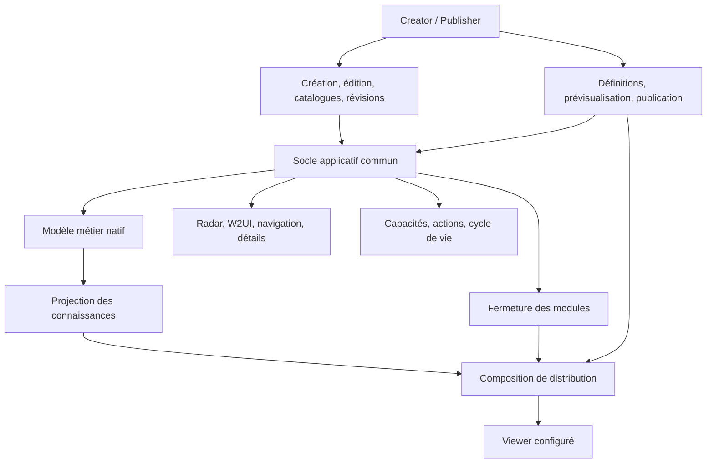

# 79 — S14.3-A8.0 : architecture commune Creator/Publisher et Viewer

## 1. Statut et portée

Statut : décision architecturale validée pour la suite du projet.

Référence source initiale : 6b969f3.
Distribution publique initiale : bf6472a.

Cette décision corrige l'orientation des lots S14.3-A6/A7.
Elle ne remet pas en cause les résultats techniques obtenus
sur la construction, les manifestes et la publication GitHub.

Elle remplace l'objectif de deux applications distinctes
partageant seulement un contrat d'échange.

Documents complémentaires :

- [Guidelines de développement](../governance/GUIDELINES-CREATOR-PUBLISHER-VIEWER.md)
- [Plan de réalisation](../governance/PLAN-REALISATION-S14-3-CREATOR-PUBLISHER-VIEWER.md)
- [Architecture de distribution](77-S14-3-DISTRIBUTION-GH-PAGES.md)
- [Prototype Client historique](78-S14-3-CLIENT-THREE-DISTRIBUTIONS.md)

## 2. Vision du produit

Standardization Radar Chart est un environnement de création,
d'édition, de consultation et de publication de connaissances
relatives à la standardisation.

Le Creator et le Publisher sont deux ensembles fonctionnels
d'une seule application.

Les mêmes acteurs construisent les catalogues et les roadmaps,
puis définissent et produisent les distributions de consultation.

Il n'existe pas de produit Publisher indépendant ni de profil
Publisher obligatoire distinct du Creator.

Le Creator/Publisher génère des Viewers adaptés à des acteurs,
organisations ou groupes d'acteurs.

Les Viewers dérivent du même socle logiciel et du même modèle
métier que le Creator/Publisher.

Ils ne constituent pas des applications réimplémentées.

## 3. Référence architecturale

La philosophie retenue est celle de Semantic Process Mediator :
réutiliser les composants applicatifs, configurer les capacités,
sélectionner les modules utiles et projeter les données
destinées aux utilisateurs de la distribution.

Cette référence définit un principe de conception.
Elle n'implique pas une identité automatique des technologies,
des contrats de données ou des implémentations entre projets.

## 4. Principes directeurs

| ID | Principe |
|---|---|
| P01 | Un socle logiciel et un modèle métier de référence |
| P02 | Une seule application Creator/Publisher |
| P03 | Des Viewers dérivés du socle commun |
| P04 | Réutilisation prioritaire des composants UI existants |
| P05 | Capacités indépendantes du mode technique |
| P06 | Projection des données avant distribution |
| P07 | Sélection des modules selon leurs dépendances |
| P08 | Définitions persistantes et livraisons identifiables |
| P09 | Prévisualisation fidèle des distributions |
| P10 | Fonctionnement réellement autonome sous file:// |
| P11 | Conservation de l'identité et des contrats métier |
| P12 | Qualification par la parité fonctionnelle |

## 5. Architecture logique

Les couches ci-dessus sont des responsabilités logiques.
Elles ne fixent pas prématurément les noms des modules,
leurs interfaces définitives ou leurs emplacements physiques.

## 6. Familles de profils

### Creator/Publisher

Application complète comportant :

- gestion du workspace et des catalogues ;
- gestion des organisations, portefeuilles et références ;
- création, édition et navigation des roadmaps ;
- gestion du cycle de vie des révisions ;
- recherche et consultation des normes ;
- définition des publications ;
- sélection des données et destinataires ;
- configuration et prévisualisation des Viewers ;
- génération et historique des distributions.

Les fonctions Publisher s'appuient sur les services et
les données du Creator, dans le même contexte applicatif.

### Viewer

Configuration de consultation du même produit.

Les capacités sont sélectionnées pour le destinataire :
navigation, consultation, recherche, comparaison,
accès aux détails, export éventuel des données reçues.

Le Viewer ne peut pas modifier les connaissances publiées,
administrer les catalogues ni produire de nouvelles publications.

Les préférences locales de consultation peuvent être modifiables
sans que cela constitue une mutation des connaissances publiées.

Les profils spécialisés sont des configurations du Viewer,
et non de nouvelles familles d'applications.

## 7. Composants applicatifs communs

| Composant existant | Responsabilité cible |
|---|---|
| Radar Cytoscape | Rendu, sélection et navigation communs |
| Géométrie et viewport | Calculs et repères communs |
| Layout et panneaux W2UI | Composition selon les capacités |
| Menus et barres d'outils | Actions déclarées et filtrées |
| Dialogues de détail | Consultation commune, édition conditionnelle |
| Explorateur du workspace | Navigation dans le périmètre disponible |
| Sélecteur de révisions | Navigation et contexte communs |
| Consultation des normes | Composants réutilisés et données configurées |
| Services de fichiers | Ouverture, export autorisé et fermeture |
| Cycle de vie applicatif | Session, erreurs, confirmations, préférences |

Les composants existants sont inventoriés et caractérisés
avant toute extraction ou transformation importante.

Une réécriture n'est acceptable qu'en présence d'une raison
documentée et d'une validation de la parité.

Aucun second moteur de rendu radar n'est retenu pour la cible.

## 8. Capacités et commandes

Les capacités sont des identifiants métier stables,
indépendants des libellés traduits et des composants UI.

Une configuration résolue détermine :

- les composants accessibles ;
- les actions enregistrées et présentées ;
- les services utilisables ;
- les dépendances logicielles nécessaires.

Trois niveaux doivent rester distincts :

1. Présentation ou absence des commandes dans l'interface.
2. Contrôle d'exécution dans les services applicatifs.
3. Inclusion ou exclusion physique des modules distribués.

Le masquage d'un bouton ne constitue pas une protection
suffisante contre l'exécution d'une mutation.

Les profils Viewer refusent par défaut les capacités
de mutation métier et de publication.

Le registre des capacités ne remplace pas les contrôles
du cycle de vie existants.

Une révision publiée reste protégée, même dans le Creator.

Les profils de consultation ne sont pas des identités
authentifiées et ne constituent pas à eux seuls un système
de contrôle d'accès à des données déjà distribuées.

## 9. Modèle métier des publications

Deux concepts sont introduits pour la conception détaillée.

### PublicationDefinition

Objet persistant, modifiable et réutilisable dans le workspace.

Il décrit notamment :

- identifiant, nom et description ;
- destinataires ou groupes d'acteurs ;
- périmètre des connaissances ;
- sélection ou règles de sélection des révisions ;
- capacités demandées ;
- configuration de présentation ;
- modes techniques souhaités ;
- politique d'inclusion des données.

L'identité et les relations vers les objets métier sont
préservées selon les contrats natifs du projet.

### PublicationRelease

Résultat identifié d'une génération.

Il référence ou enregistre :

- la définition de publication utilisée ;
- sa configuration résolue ;
- les révisions et versions de données effectivement retenues ;
- la provenance du code ;
- les modules sélectionnés ;
- le mode technique ;
- les artefacts et leurs empreintes ;
- les résultats de validation.

Une livraison est stable après génération.
Une évolution produit une nouvelle livraison.

Ces noms désignent des concepts cibles.
Leur schéma exact, leur persistance, leur versionnement et
leur intégration au graphe seront spécifiés et testés
dans le lot métier correspondant.

Aucun second modèle indépendant de workspace n'est introduit.

## 10. Publication de révisions et publication de Viewers

Ces deux opérations sont distinctes.

Publier une révision stabilise un objet métier.

Publier un Viewer compose un ensemble de connaissances,
des capacités et des composants logiciels pour un destinataire.

Une révision peut être distribuée dans plusieurs Viewers.

Un Viewer peut contenir plusieurs roadmaps, révisions,
organisations et portefeuilles.

La publication d'un Viewer ne doit pas modifier implicitement
le cycle de vie des révisions qu'il distribue.

Une définition réutilisable peut sélectionner dynamiquement
des révisions lors de la génération.

La livraison conserve les identifiants et versions résolus,
pour permettre sa traçabilité.

## 11. Projection des connaissances

La cible est une projection contrôlée du modèle métier natif.

La sélection peut porter sur les roadmaps, les portefeuilles,
les révisions, les références normatives, les évaluations,
les groupes de travail et d'autres objets pertinents.

La projection doit respecter :

- identité stable des objets ;
- fermeture des références nécessaires ;
- cohérence des relations ;
- états de cycle de vie autorisés ;
- exclusion des données non retenues ;
- sélection explicite des attributs distribuables ;
- préservation des coordonnées et de la sémantique du radar.

Une dépendance nécessaire mais non autorisée ne doit pas
être ajoutée silencieusement au périmètre.

Le moteur doit signaler le conflit et refuser la génération
ou appliquer une politique explicite de projection compatible.

Les brouillons, notes privées et données internes sont exclus
par défaut des publications de consultation.

Les extensions ou types inconnus sont traités explicitement,
sans export aveugle des propriétés du workspace.

Le catalogue ISO global n'est pas embarqué dans un Viewer
simplement parce que le Creator le possède.

Un sous-ensemble de catalogue peut être distribué lorsque
la définition de publication le prévoit.

La projection experimental v2 existante reste un format
d'échange minimal et une référence de tests.

Elle ne devient pas le modèle métier universel du Viewer.

## 12. Configuration de distribution

Une distribution résulte de la composition :

    profil fonctionnel
    + capacités résolues
    + configuration de présentation
    + modules nécessaires
    + projection des connaissances
    + mode technique
    + manifeste de provenance

Ces dimensions sont indépendantes.

Une modification du mode technique ne doit pas modifier
le périmètre métier ou les capacités de la publication.

La fermeture des modules dépend du graphe de dépendances
et des capacités réellement retenues.

Les scripts classiques et dépendances globales historiques
sont adaptés progressivement.

Une distribution transitoire peut encore contenir du code
inactif ; elle doit être identifiée comme telle.

Elle ne constitue pas une preuve de filtrage physique final.

## 13. Prévisualisation

Le Creator/Publisher doit permettre la prévisualisation
du Viewer correspondant à une définition de publication.

La prévisualisation utilise les composants communs,
les capacités résolues et la projection effective des données.

Elle ne doit pas consulter implicitement le workspace complet.

Le contexte de prévisualisation est isolé du contexte
d'édition pour éviter les mutations accidentelles.

Le retour au Creator préserve le travail en cours.

La prévisualisation ne remplace pas la qualification
de l'artefact réellement généré.

## 14. Cycle de vie applicatif

Le Creator/Publisher et les Viewers partagent des services
d'ouverture, fermeture, remplacement de contexte,
gestion d'erreurs, confirmation et préférences.

Les commandes internes de fermeture ou remplacement
demandent confirmation selon la politique du profil.

Les modifications non enregistrées sont protégées.

Le navigateur contrôle les événements beforeunload :
un dialogue personnalisé ne peut pas être garanti
pour toutes les fermetures d'onglet ou de fenêtre.

Cette limite doit être documentée et testée.

## 15. Modes techniques

| Mode | Contrat |
|---|---|
| Standalone | Un HTML autonome, fonctionnement sans serveur |
| Bundled | HTML et un seul JavaScript applicatif packagé |
| Modules | Modules ES6 natifs, non packagés, servis en HTTP |

Les trois modes existent pour les deux familles de produits.

Les styles, données et autres ressources du mode HTTP
peuvent être distribués séparément selon leur contrat.

Le standalone embarque les ressources nécessaires.
Il ne dépend pas d'une requête réseau pour son usage normal.

Le Creator/Publisher autonome doit pouvoir générer
des Viewers sans installation de Node.js, Vite ou Git.

Le catalogue nécessaire à son usage hors ligne doit être
embarqué ou fourni par un mécanisme local explicite.

La disponibilité d'IndexedDB sous file:// n'est pas présumée.
Les sauvegardes et restaurations par fichiers doivent être
qualifiées indépendamment des mécanismes de stockage locaux.

## 16. Construction logicielle et publication métier

Deux responsabilités sont séparées.

La chaîne de développement construit les composants
et artefacts logiciels réutilisables.

Le Publisher compose les distributions métier avec
les ressources logicielles et les données sélectionnées.

La génération dans le navigateur peut s'appuyer sur
des artefacts logiciels préconstruits.

La stratégie exacte de composition sélective, les variantes
préconstruites et les mécanismes d'assemblage restent
à qualifier par des preuves techniques.

Une simple concaténation de scripts non maîtrisés
ne constitue pas le contrat final du bundle.

Le Creator autonome doit disposer des ressources de
publication nécessaires à son périmètre de génération.

## 17. Confidentialité et distribution

Les données non autorisées sont exclues de l'artefact.

Le masquage dans l'interface ne protège pas le contenu
d'un HTML, d'un JavaScript ou d'un JSON distribué.

Les données d'un Viewer peuvent être inspectées par
son destinataire.

Les destinations et groupes d'acteurs servent à définir
le périmètre et la livraison, non à garantir une
authentification dans un fichier autonome.

Une publication métier confidentielle ne doit pas être
envoyée sur GitHub Pages public.

Les mécanismes de distribution privée, authentification
ou chiffrement dépendent du besoin de gouvernance.

Un fichier autonome déjà remis ne peut pas être révoqué
à distance par une simple modification de configuration.

## 18. Infrastructure conservée

Les éléments suivants restent des acquis :

- Node 22 et Vite ;
- séparation des sources main et des exécutables gh-pages ;
- assemblage multi-produits ;
- manifestes et contrôle SHA-256 ;
- provenance des distributions ;
- vérification des chemins et ressources ;
- publication atomique fast-forward ;
- portail et compatibilité des entrées historiques.

L'intégrité SHA-256 ne constitue pas à elle seule
une preuve cryptographique d'authenticité de l'émetteur.

La publication logicielle GitHub et la publication métier
de Viewers sont deux opérations distinctes.

## 19. Transition depuis A6/A7

Le Client actuel est un prototype expérimental minimal.

Il dispose d'une présentation HTML/SVG propre et ne partage
pas suffisamment les composants UI historiques.

Ses trois modes sont construits et publiés.

Les 464 tests, les contrôles de manifestes et les 19
ressources HTTP positives ont été validés.

Les contrôles HTTP négatifs ont rencontré des 503 ;
ils ne constituent pas une qualification complète.

La recette navigateur complète reste à terminer.

Ce prototype est conservé temporairement pour :

- compatibilité des distributions existantes ;
- tests du format minimal experimental v2 ;
- référence de construction autonome ;
- référence de vérification des manifestes.

Il ne doit plus recevoir de développements fonctionnels
qui dupliqueraient le Creator.

Sa substitution se fera après qualification du Viewer commun.

Les URL historiques ne sont pas supprimées sans stratégie
de compatibilité explicite.

## 20. Exigences de convergence

| ID | Exigence |
|---|---|
| CPV-01 | Creator et Publisher dans une seule application |
| CPV-02 | Radar et composants UI réellement partagés |
| CPV-03 | Capacités contrôlées à l'exécution |
| CPV-04 | Définitions de publication persistantes |
| CPV-05 | Livraisons identifiables et traçables |
| CPV-06 | Projection native fermée et filtrée |
| CPV-07 | Prévisualisation fidèle et isolée |
| CPV-08 | Exclusion physique des modules inutiles |
| CPV-09 | Parité dans les trois modes techniques |
| CPV-10 | Creator/Publisher autonome capable de publier |
| CPV-11 | Protection du cycle de vie et des révisions |
| CPV-12 | Absence de fuite de données hors périmètre |

Ces exigences constituent un complément normatif
à la spécification cible.

Leur intégration au registre d'exigences existant
devra respecter le schéma de ce registre.

## 21. Qualification finale

Le critère de réussite n'est pas le nombre de pages HTML
générées, mais le fonctionnement d'un produit commun.

La qualification doit démontrer :

- un même radar et une même sémantique graphique ;
- une navigation et des dialogues communs ;
- l'absence de mutation métier dans le Viewer ;
- la conservation du comportement Creator ;
- la sélection et la fermeture des données ;
- la suppression des dépendances inutiles ;
- la prévisualisation fidèle ;
- la génération de publications dans les trois modes ;
- le fonctionnement hors ligne des standalone ;
- la conservation des sauvegardes et révisions ;
- l'intégrité et la provenance des artefacts.

Le plan de réalisation définit les portes de validation.

## 22. Questions techniques ouvertes

Les décisions de produit sont établies.

Restent à préciser par l'implémentation :

- le point d'entrée commun et l'ordre d'initialisation ;
- les frontières exactes des modules historiques ;
- la représentation native des objets de publication ;
- les règles de projection par type de connaissance ;
- la composition physique dans le navigateur ;
- la gestion des ressources volumineuses embarquées ;
- la persistance sous file:// et son repli sur fichiers ;
- les limites de taille et de performance des distributions.

Ces questions ne justifient pas la création d'un nouveau
moteur graphique ou d'une application Publisher distincte.
