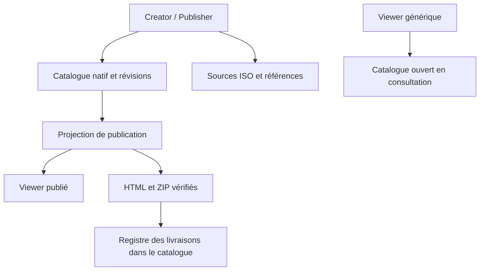
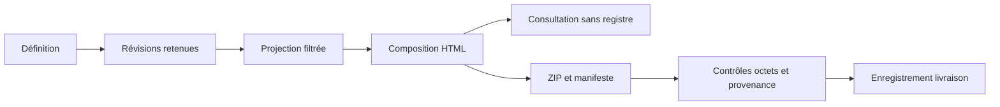

# Architecture réalisée — Standardization Radar Chart A8.6

**AS-IS** · 15 novembre 2026 · application `f7939c362cd9343cd92b6087235b8a29d2c06765` · release `894ae2a1ed25f7cef6bbbb56b3d2520792ecdc55` · tag `pilot-a86`. Ce document synthétise la réalisation, pas une spécification de toutes les capacités cibles. Voir [preuve 09](../evidence/09-A86-FINAL-QUALIFICATION.md) et [preuve 10](../evidence/10-A86-PUBLICATION.md).

## 1. Périmètre et composants

Le Creator et le Publisher sont intégrés ; le Viewer partage le moteur mais possède des capacités réduites. Le Viewer générique peut ouvrir un catalogue ; le Viewer publié est lié à une projection immuable, sans remplacement de catalogue. Une publication peut contenir un radar ou une collection, une seule révision publiée explicitement retenue par radar. Aucune règle de dernière version ni modèle temporel d'applicabilité n'est implicite. Voir [79](79-S14-3-COMMON-CREATOR-PUBLISHER-VIEWER.md), [80](80-S14-3-COMMON-APPLICATION-PROFILES.md), [86-R1](86-R1-S14-3-RADAR-CENTRIC-PUBLISHED-VIEWER.md).

## 2. Interface et représentation graphique

`radar.html` initialise les composants classiques ; `js/radar.js` et `js/blips.js` participent au moteur. W2UI possède le layout et ses panneaux, SVG/D3 la géométrie, Cytoscape le graphe interactif et les blips. Le radar publié présente une fiche descriptive à gauche, le radar au centre, la consultation contextuelle à droite et les références dans le panneau inférieur. `radar-workspace-explorer.js` et `radar-standards-panel.js` coordonnent le radar actif et les références. `radar-application-profile.js` gère les capacités. Les tests viewport et les documents historiques de géométrie restent utiles ; ne pas déduire une qualification exhaustive de tous les navigateurs.

## 3. Modèle d'information et persistance

| Domaine | Modules de référence |
|---|---|
| Catalogue natif et adaptation graphe | `radar-catalog-persistence.js`, `radar-catalog-adapter.js` |
| Création et administration | `radar-catalog-creation.js`, `radar-catalog-create-form.js`, `radar-radar-admin.js` |
| Cycle de vie | `radar-revision-session.js`, `radar-revision-dialogs.js` |
| Références et standards | `radar-standard-registry.js`, `radar-standards-panel.js` |
| Catalogue et navigation | `radar-catalog-ui.js`, `radar-workspace-explorer.js` |

Le catalogue JSON sérialise les objets métier, leurs identités, révisions et relations ainsi que les extensions de publication. Les révisions publiées sont protégées ; les modifications passent par les parcours autorisés. Voir [architecture catalogue](ARCHITECTURE-CATALOGUE-ETAT-COURANT.md), [cycle de vie](08-S13-CYCLE-VIE-REVISIONS.md). Sauvegarder/exporter le JSON reste une opération distincte de générer ou télécharger une livraison. Pas de stockage durable des ZIP dans le catalogue ; pas de nouveau format Workspace.

## 4. Sources et consultation ISO

`radar-iso-open-data.js`, `radar-iso-windowed-db.js`, `radar-iso-stream-distribution.js`, `radar-catalog-distribution.js` et `radar-s14-z-sources.js` constituent des points d'entrée de l'acquisition, du stockage/indexation et de la distribution. Les sources globales ISO sont distinctes des références natives associées aux standards du catalogue. Le Creator autonome embarque la distribution ISO ; le Viewer n'embarque que les données nécessaires à son usage, et un Viewer publié reçoit les références projetées. Les détails ISO natifs sont consultables dans le Viewer. Voir [conception ISO](CONCEPTION-CONSULTATION-ISO.md), [sources](INVENTAIRE-SOURCES-CATALOGUES.md), [82](82-S14-3-ISO-REFERENCE-INTEGRATION.md). Les simplifications de sources, l'enrichissement non-ISO et l'ergonomie restent des axes métier.

## 5. Flux de publication métier

`radar-publication-model.js` définit les contrats, `radar-publication-projection.js` prépare la projection, `radar-publication-viewer.js` compose et initialise le Viewer, `radar-publication-delivery.js` assemble et vérifie le ZIP, `radar-publication-ui.js` orchestre les commandes. `radar-artifact-integrity.js` utilise SHA-256 WebCrypto. Le schéma [publications-v1](schemas/publications-v1.schema.json) documente le contrat de publication ; les contrats d'exécution et la validation native restent déterminants.

La consultation autonome Final télécharge un HTML candidat unique, sans création de livraison. Le parcours HTTP sans template conserve l'iframe. H1 a éliminé la navigation `blob:null` incompatible avec WebCrypto et les URL relatives ; la cause du défaut ISO iframe initial n'est pas établie. Le ZIP métier contient `viewer.html` et `manifest.json` et est vérifié avant enregistrement. Le registre conserve définition historique, révisions résolues, provenance, empreintes, contrôles et motif facultatif. L'identité binaire du Viewer est comparée avant régénération ; le numéro Lxxx est un affichage, l'UUID demeure l'identité. Le retéléchargement réutilise le dernier Blob du dialogue courant sans mutation. Pas de statut de diffusion officielle déduit de la génération. Voir [83](83-S14-3-PUBLICATION-MODEL.md), [84](84-S14-3-NATIVE-PUBLICATION-PROJECTION.md), [85](85-S14-3-PUBLISHER-UI-AND-PREVIEW.md), [86](86-S14-3-STANDALONE-PUBLICATION-DELIVERY.md), [86-R2](86-R2-S14-3-PUBLICATION-CONFIGURATION-AND-PREVIEW.md).

## 6. Distribution logicielle et qualification

Vite et les scripts de build conservent l'architecture hybride modules/scripts classiques. Les HTML autonomes sont publiés comme assets de GitHub Releases, le site statique via gh-pages ; les variantes historiques Client/PLM demeurent distinctes. Voir [87](87-A86-DISTRIBUTION-RELEASES-PAGES.md). 603 tests réussis pour le commit de release, 602 pour la baseline applicative, 11 contrôles H1 et 6 Final. Tests automatisés pertinents : `radar-a83-publications.test.mjs`, `radar-a84-projection.test.mjs`, `radar-a85-publisher.test.mjs`, `radar-a86-pages-provenance.test.mjs`, `web-distribution.test.mjs`. Les preuves utilisateur attestent les parcours locaux ; la recette publique navigateur reste à enregistrer.

## 7. Limites et trajectoire

Pas d'archivage des ZIP historiques ni de Workspace multi-ressources ; pas de comparaison sémantique détaillée des blips entre livraisons ; pas de prévisualisation autonome sans téléchargement ; composition physique complète et parité des trois modes non qualifiées. Les études SPM restent référencées dans 86-R2, sans dépendance ni modification de SPM. Priorité suivante : enrichissements métier standards/sources, édition et consultation du radar. La [spécification cible](02-SPECIFICATION-CIBLE.md) reste distincte de cet état réalisé ; voir [revue des exigences](../requirements/A86-RECONCILIATION.md).
